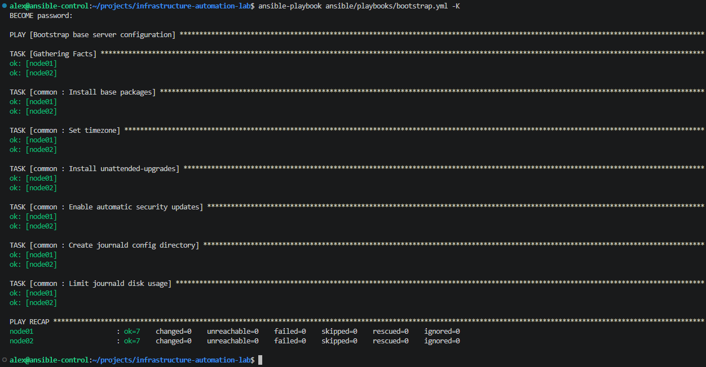
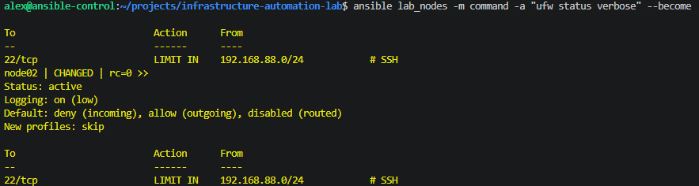
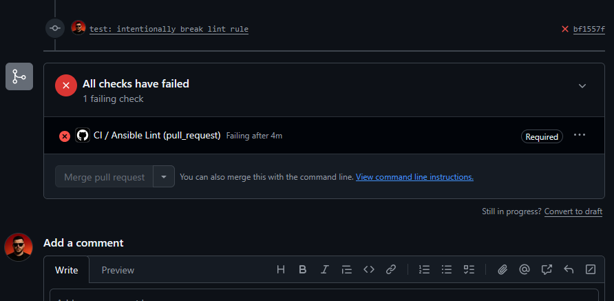
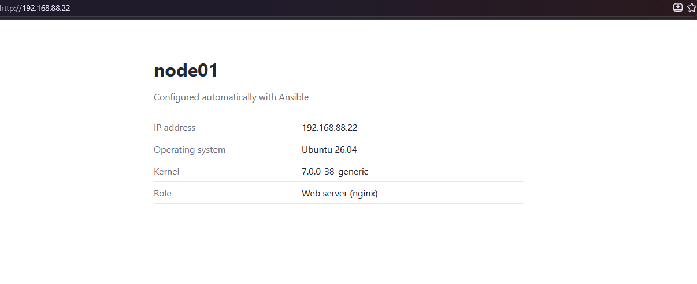

# Infrastructure Automation Lab

Automated provisioning, configuration and hardening of Linux servers using Ansible.

> 🚧 Work in progress

## Business Problem
A company needs to prepare multiple Linux servers consistently, securely and repeatably,
without manual, error-prone configuration.

## Planned Scope
- [x] Automation user and SSH hardening
- [x] Firewall rules
- [x] Base packages
- [x] Nginx web server with health endpoint
- [ ] Docker host
- [ ] Security hardening
- [x] Automatic updates and logging
- [ ] Python health-check tool
- [ ] Idempotent runs
- [x] CI: linting and tests on every pull request

## Tech Stack
Ansible · Linux (Ubuntu Server) · Python · Bash · GitHub Actions

## Evidence

### Idempotency
The second run of the bootstrap playbook makes no changes (`changed=0`),
which shows that the configuration is idempotent and safe to re-apply.

### Firewall
Default deny for incoming traffic. SSH is allowed only from the lab subnet with rate limiting.
A test HTTP server on port 8080 is reachable locally but blocked from the network.

### CI quality gate
Every pull request runs `ansible-lint` in GitHub Actions. The `main` branch is protected:
merging is blocked until the check passes.

### Web server
`node01` serves a page generated from a Jinja2 template with host facts.
Configuration is tested with `nginx -t` before every reload.

## Security

### Lab vs Production
This project runs in a self-hosted home lab. Some choices are simplified on purpose,
and the table below shows what I would do differently in production.

| Area | Lab setup | Production approach |
|---|---|---|
| Control node SSH key | Ed25519 key without passphrase, used for automation | Passphrase-protected key with ssh-agent, or short-lived SSH certificates (e.g. HashiCorp Vault SSH CA) |
| Privilege escalation | Dedicated `ansible` user with key-only SSH access and passwordless sudo (`NOPASSWD:ALL`) | Sudo rules scoped to required commands, short-lived credentials, access audited centrally |
| SSH access | Key-only authentication, root login disabled, `AllowUsers` allowlist, config validated with `sshd -t` before applying | Same, plus SSH reachable only from a bastion or VPN, and centralized auth (e.g. SSH CA or SSO) |
| Network | UFW on every node: default deny incoming, SSH allowed only from the lab subnet with rate limiting | Isolated management network/VLAN, cloud security groups or network firewalls, SSH reachable only via bastion or VPN |
| IP addresses | Private RFC 1918 lab addresses in the inventory | Dynamic inventory from the cloud provider or CMDB, no hardcoded addresses |

### Secrets
- No secrets, passwords or private keys are stored in this repository.
- `.gitignore` excludes key files, `.env` files and vault password files.
