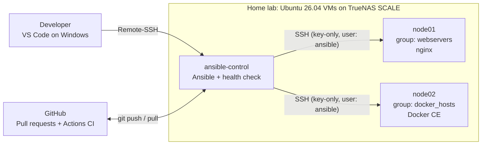
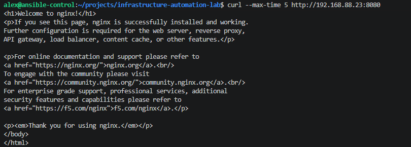
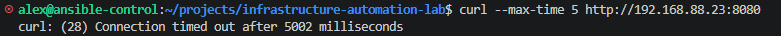
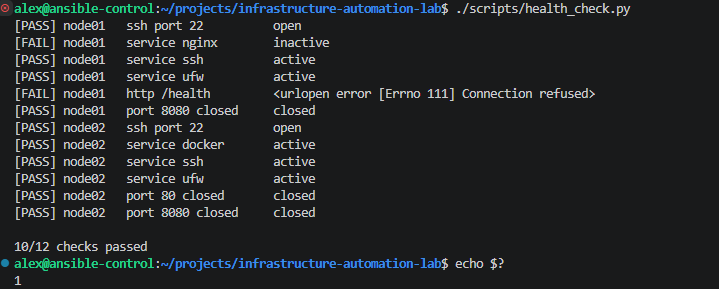
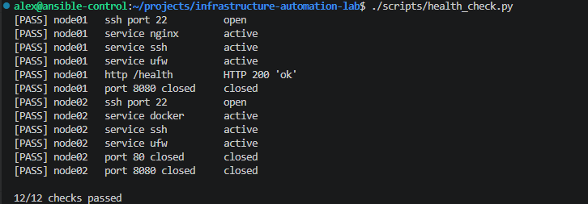

# Infrastructure Automation Lab

[](https://github.com/alexpetrow/infrastructure-automation-lab/actions/workflows/ci.yml)

Automated provisioning, hardening and service configuration of Linux servers with Ansible,
validated by CI and verified by a Python health-check tool.

> This is a self-hosted engineering lab running on virtual machines in my home lab.
> It is not a production system. Simplifications and the production approach
> are documented in [Security](#security) and [Trade-offs](#trade-offs-and-next-steps).

## Business Problem

A company needs to prepare multiple Linux servers consistently, securely and repeatably.
Manual configuration is slow, error-prone and leaves no record of what was changed.

This project turns that work into code:

- **One command** brings every server to the desired state: `ansible-playbook ansible/playbooks/site.yml`.
- **Idempotent:** running it again changes nothing if the servers are already correct.
- **Self-correcting:** manual changes (configuration drift) are reverted on the next run.
- **Verifiable:** a health check confirms the actual state, CI checks every change before merge.

## Architecture



| Host | Groups | Purpose |
|---|---|---|
| `ansible-control` | – | Runs Ansible, the health check and holds the repository |
| `node01` | `lab_nodes`, `webservers` | Web server with nginx |
| `node02` | `lab_nodes`, `docker_hosts` | Container host with Docker CE |

## Features

- [x] Base packages, timezone, automatic security updates, journald size limits
- [x] Dedicated automation user with key-only SSH access
- [x] SSH hardening: no root login, no passwords, user allowlist, config validated before restart
- [x] Kernel hardening based on CIS Benchmark recommendations
- [x] UFW firewall: default deny, SSH only from the lab subnet with rate limiting
- [x] nginx with templated configuration, security headers and a `/health` endpoint
- [x] Docker CE from the official signed repository, with log rotation and `live-restore`
- [x] Python health-check tool with unit tests
- [x] CI on every pull request: `ansible-lint`, `ruff`, `pytest`; protected `main` branch

## Tech Stack

| Technology | Used for |
|---|---|
| Ansible | Configuration management (roles, playbooks, group_vars) |
| Ubuntu Server 26.04 LTS | Operating system on all hosts |
| Python 3 | Health-check tool (standard library only) |
| pytest, ruff | Unit tests, linting and formatting |
| GitHub Actions | CI pipeline and merge quality gate |
| UFW, sysctl, OpenSSH | Host security |
| nginx, Docker CE | Services deployed on the nodes |

## Repository Structure

```
.
├── ansible.cfg                     # Project-wide Ansible settings
├── requirements.yml                # Required Ansible collections
├── ansible/
│   ├── inventories/lab/
│   │   ├── hosts.yml               # Hosts and groups
│   │   └── group_vars/             # Environment-specific variables
│   ├── playbooks/
│   │   ├── site.yml                # Entry point: configures everything
│   │   ├── bootstrap.yml           # Base configuration for all nodes
│   │   ├── webservers.yml
│   │   └── docker_hosts.yml
│   └── roles/
│       ├── common/                 # Packages, timezone, updates, journald
│       ├── users/                  # Automation account and sudo rule
│       ├── ssh_hardening/          # sshd configuration
│       ├── hardening/              # Kernel sysctl hardening
│       ├── firewall/               # UFW rules
│       ├── nginx/                  # Web server
│       └── docker/                 # Docker CE
├── scripts/health_check.py         # State verification tool
├── tests/                          # Unit tests for the health check
├── docs/
│   ├── troubleshooting.md          # Real issues found and how they were solved
│   └── images/                     # Evidence screenshots
└── .github/workflows/ci.yml        # CI pipeline
```

## Roles

| Role | Applied to | What it does |
|---|---|---|
| `common` | all nodes | Base packages, timezone, unattended security upgrades, journald size limit |
| `users` | all nodes | Creates `ansible` user, authorizes the control node key, sudo rule validated with `visudo` |
| `ssh_hardening` | all nodes | sshd drop-in config validated with `sshd -t` before restart |
| `hardening` | all nodes | CIS-based sysctl settings, with IP forwarding kept on for Docker |
| `firewall` | all nodes | UFW default deny, SSH rate limiting, extra ports from `group_vars` |
| `nginx` | `webservers` | Jinja2-templated site, security headers, `/health`, config tested with `nginx -t` before reload |
| `docker` | `docker_hosts` | Official repository with signed packages, `daemon.json` validated with `dockerd --validate` |

Every critical configuration file is **validated before it is applied**, so a mistake
cannot lock out access or take a service down.

## Getting Started

### Prerequisites

- A control node and one or more managed nodes running Ubuntu Server 26.04 (24.04 also works)
- SSH key access from the control node to an initial admin user with sudo on each node
- Python 3.10+ and [pipx](https://pipx.pypa.io/) on the control node

### Setup

```bash
git clone git@github.com:alexpetrow/infrastructure-automation-lab.git
cd infrastructure-automation-lab

pipx install --include-deps ansible
ansible-galaxy collection install -r requirements.yml
```

Edit the inventory for your environment:

- `ansible/inventories/lab/hosts.yml`: host names and IP addresses
- `ansible/inventories/lab/group_vars/lab_nodes.yml`: subnet allowed to reach SSH
- `ansible/roles/ssh_hardening/defaults/main.yml`: users allowed to log in over SSH

### First run

On fresh servers the `ansible` user does not exist yet, so the first run uses the initial admin
user and asks for its sudo password:

```bash
ansible-playbook ansible/playbooks/site.yml -e ansible_user=<admin-user> -K
```

### Every run after that

```bash
ansible-playbook ansible/playbooks/site.yml --check --diff   # preview changes
ansible-playbook ansible/playbooks/site.yml                  # apply
```

## Health Check

`scripts/health_check.py` reads hosts from the Ansible inventory and verifies the expected
state of each server based on its groups:

| Group | Checks |
|---|---|
| `lab_nodes` | SSH reachable, `ssh` and `ufw` services active, port 8080 closed |
| `webservers` | `nginx` active, `/health` returns HTTP 200 `ok` |
| `docker_hosts` | `docker` active, port 80 closed (detects containers bypassing UFW) |

```bash
./scripts/health_check.py          # human-readable report
./scripts/health_check.py --json   # machine-readable output
```

Exit codes: `0` all checks passed, `1` at least one check failed, `2` inventory could not be loaded.

## Testing and CI

| Check | Where | What it catches |
|---|---|---|
| `ansible-lint` | CI + local | Syntax errors, deprecated modules, bad practices |
| `ruff check` / `ruff format --check` | CI + local | Python bugs and style issues |
| `pytest` | CI + local | Regressions in health-check logic |
| `--check --diff` | Local | Unexpected changes before applying |
| Second run with `changed=0` | Local | Non-idempotent tasks |
| `health_check.py` | Local | Actual state differs from desired state |

The `main` branch is protected: changes go through pull requests and cannot be merged
until all CI checks pass.

## Security

### Lab vs Production

| Area | Lab setup | Production approach |
|---|---|---|
| Control node SSH key | Ed25519 key without passphrase, used for automation | Passphrase-protected key with ssh-agent, or short-lived SSH certificates (e.g. HashiCorp Vault SSH CA) |
| Privilege escalation | Dedicated `ansible` user with key-only SSH access and passwordless sudo (`NOPASSWD:ALL`) | Sudo rules scoped to required commands, short-lived credentials, access audited centrally |
| SSH access | Key-only authentication, root login disabled, `AllowUsers` allowlist, config validated with `sshd -t` before applying | Same, plus SSH reachable only from a bastion or VPN, and centralized auth (e.g. SSH CA or SSO) |
| Network | UFW on every node: default deny incoming, SSH allowed only from the lab subnet with rate limiting | Isolated management network/VLAN, cloud security groups or network firewalls, SSH reachable only via bastion or VPN |
| Kernel hardening | sysctl settings based on CIS Benchmark; IP forwarding kept on for Docker | Full CIS Benchmark compliance scanned with tools like Lynis or OpenSCAP, exceptions documented and approved |
| Docker access | Official Docker CE repository with GPG-signed packages; `alex` in the `docker` group (root-equivalent, documented); container log size limited | Rootless Docker or sudo-only access; image scanning; container ports bound to localhost or filtered in `DOCKER-USER` |
| IP addresses | Private RFC 1918 lab addresses in the inventory | Dynamic inventory from the cloud provider or CMDB, no hardcoded addresses |

### Secrets

- No secrets, passwords or private keys are stored in this repository.
- `.gitignore` excludes key files, `.env` files and vault password files.
- CI runs with read-only repository permissions.

## Real Issues Solved

Problems found while building the lab, documented in [docs/troubleshooting.md](docs/troubleshooting.md):

- **Ansible `become` timeout on Ubuntu 26.04:** the new default `sudo-rs` is incompatible with
  how Ansible detects the sudo prompt. Fixed in the inventory without system-wide changes.
- **Docker published ports bypass UFW:** a container port was reachable from the network
  despite default deny. Mitigated by binding container ports to localhost; the health check
  detects the issue if it comes back.
- **SSH lockout risk:** sshd reads drop-in files in order and the first value wins, so the
  hardening file is named `10-` to take priority over `50-cloud-init.conf`.

## Evidence

### Idempotency
The second run of the playbook makes no changes.


### Firewall
Default deny for incoming traffic. A test server on port 8080 works locally but is blocked from the network.


### Web server
Page generated from a Jinja2 template with facts collected from the host.


### Docker and firewall interaction
A published container port bypasses UFW; the same container bound to localhost is not reachable from the network.




### Detect and remediate
The health check detects a stopped nginx service, Ansible restores the desired state,
and the health check confirms recovery.




### CI quality gate
A pull request with a lint error cannot be merged.


## Trade-offs and Next Steps

| Current approach | Why | Next step |
|---|---|---|
| VMs created manually in TrueNAS | Kept the focus on configuration management first | Provision VMs with Terraform (Proxmox provider), then configure them with Ansible |
| Roles tested by running them against the lab | Fast feedback with real servers | Role tests with Molecule in disposable containers, run in CI |
| No secrets needed yet | Current roles do not use passwords or tokens | Ansible Vault or an external secrets manager when roles require secrets |
| Static inventory | Small, stable lab | Dynamic inventory when hosts are created automatically |
| Health check run manually | Simple and transparent | Prometheus metrics and alerting (see my observability project) |
